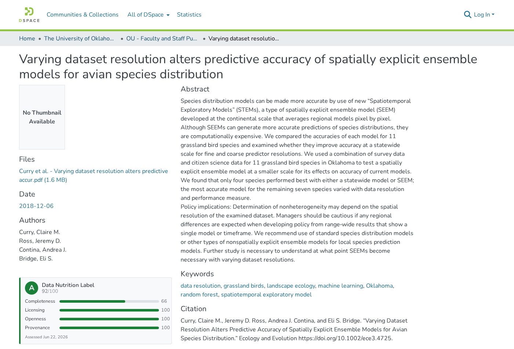
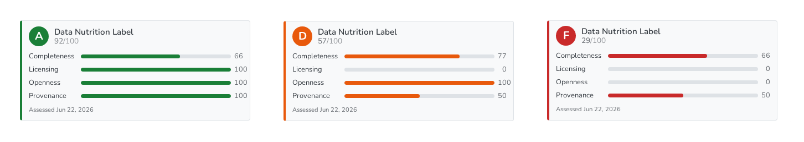
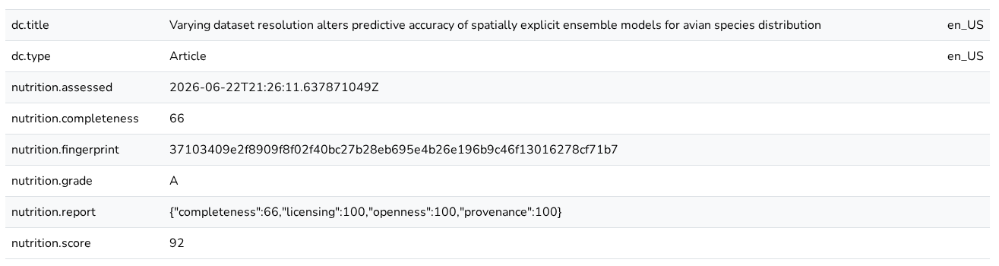

# Data Nutrition Label for DSpace 9.2

Gives every archived item a 0–100 quality score and an A–F grade, and shows them as a badge on the item page. Inspired by the [Data Nutrition Project](https://datanutrition.org/)'s standardized dataset-quality label.

The label is stored as ordinary `nutrition.*` metadata, so it is also available through REST, OAI-PMH and CSV exports, with or without the UI.



- **Base:** DSpace 9.2 and DSpace Angular 9.2
- **Requires:** Java 17, Maven 3.8+, PostgreSQL; Node 22, npm 10
- **Delivered as:** one patch file, [`data-nutrition.patch`](data-nutrition.patch), holding a series for each repository. No upstream class is modified.

---

## What's in the patch

| Series | Repository | Adds |
|---|---|---|
| `[PATCH backend 1/4 … 4/4]` | [DSpace](https://github.com/DSpace/DSpace) | Scorer, event consumer, `datanutrition` curation task, `nutrition` metadata schema, Spring bean, and config in `dspace.cfg`, `modules/curate.cfg`, `modules/rest.cfg` |
| `[PATCH angular 1/4 … 4/4]` | [dspace-angular](https://github.com/DSpace/dspace-angular) | Item-page badge, feature-switch service, curation-form and full-item-page filtering, translations, specs |

## Installation

### 1. Apply the patch

Split the file, then apply each series to its own repository. The `| sort` matters: it keeps the commits in order.

```bash
mkdir dn && git mailsplit -odn data-nutrition.patch
cd DSpace            && git am --3way $(grep -l '^Subject: \[PATCH backend' ../dn/* | sort)
cd ../dspace-angular && git am --3way $(grep -l '^Subject: \[PATCH angular' ../dn/* | sort)
```

### 2. Check the event consumer is active

The patch adds `nutrition` to `event.dispatcher.default.consumers` in `dspace.cfg`. A `local.cfg` that sets this property **replaces** the list rather than appending to it, so add `nutrition` there too:

```properties
event.dispatcher.default.consumers = versioning, discovery, eperson, qaeventsdelete, ldnmessage, nutrition
```

Confirm the value DSpace actually resolves:

```bash
[dspace]/bin/dspace dsprop -p event.dispatcher.default.consumers
```

### 3. Build and deploy

```bash
# Backend
mvn clean package
cd dspace/target/dspace-installer && ant update
sudo systemctl restart tomcat           # or your servlet container

# UI
npm install
npm run build:prod
pm2 restart dspace-ui                   # or however you serve SSR
```

### 4. Load the schema and backfill existing items

Run these once per environment:

```bash
[dspace]/bin/dspace registry-loader -metadata [dspace]/config/registries/nutrition-types.xml
[dspace]/bin/dspace curate -t datanutrition -i all
```

### Using a theme other than `dspace`

The UI series overrides `untyped-item` in `src/themes/dspace`. For another theme:

1. Move `nutrition-label/` and the `untyped-item.component.*` files to the same path under `src/themes/<your-theme>/`, and fix the relative imports.
2. Register `UntypedItemComponent` in that theme's `eager-theme.module.ts` `DECLARATIONS`.
3. Set the last argument of `@listableObjectComponent(...)` to your theme name.

If your theme already overrides the template, add only the tag below, plus `NutritionLabelComponent` in the component's `imports`:

```html
<ds-nutrition-label [item]="object"></ds-nutrition-label>
```

## How it works

### When items are scored

- **At archival** (`Item+Install`), and again after any substantive edit (`Modify`, `Modify_Metadata`, `Add`, `Remove`), by the event consumer.
- **On demand** with the curation task. `-i` takes a **handle**, not a UUID:

```bash
[dspace]/bin/dspace curate -t datanutrition -i 123456789/42   # one item
[dspace]/bin/dspace curate -t datanutrition -i all            # whole repository
```

Drafts and items still in workflow are never scored, so the first label reflects the approved version.

### Scoring rubric

The score is the unweighted average of four 0–100 dimensions. Adjust `NutritionScorerImpl` to suit local policy.

| Dimension | Score |
|---|---|
| **completeness** | Presence of 4 required (`dc.title`, `dc.contributor.author`, `dc.date.issued`, `dc.type`) and 5 recommended fields |
| **licensing** | 100 with `dc.rights` or `dc.rights.uri`, otherwise 0 |
| **openness** | Share of ORIGINAL bitstreams in CSV, JSON, text, XML, PDF, PNG or TIFF |
| **provenance** | 50 for `dc.identifier.uri`, plus 50 for funding/sponsorship metadata |

Grades: **A** ≥ 90, **B** ≥ 75, **C** ≥ 60, **D** ≥ 40, otherwise **F**.

> An item with no ORIGINAL bitstreams gets 0 for openness, so it can score at most 75. For metadata-only records, consider excluding or reweighting this dimension.



### Metadata written

All fields belong to the `nutrition` schema (namespace `http://dspace.org/namespace/nutrition/`, following DSpace's `local` schema convention; change it in `nutrition-types.xml` before loading if your site uses its own). They are written by the system, so keep them out of submission forms.

| Field | Contents |
|---|---|
| `nutrition.score` / `nutrition.grade` | Overall score (0–100) and A–F grade |
| `nutrition.completeness` | Completeness sub-score |
| `nutrition.report` | JSON breakdown of all dimensions |
| `nutrition.assessed` | ISO-8601 assessment time |
| `nutrition.fingerprint` | SHA-256 hash used by the recursion guard (internal) |



### The UI

The badge shows the grade, score, a bar per dimension and the assessment date. Colours follow the grade: green for A/B, amber for C/D, red for F. Items without a label show nothing. If `nutrition.report` is malformed, the badge falls back to the grade alone.

## Configuration

A single switch controls the whole feature. Set it in `local.cfg`:

```properties
nutrition.label.enable = false
```

Use this switch instead of removing `nutrition` from the dispatcher list. The UI reads it over REST (exposed in `modules/rest.cfg`), so there is no separate frontend setting. When the switch is off:

| Where | Effect |
|---|---|
| Event consumer and curation task | Do nothing; existing labels are kept |
| Item page badge | Hidden |
| Full item page | `nutrition.*` rows hidden |
| Admin curation menu | `datanutrition` removed |

If the UI can't read the property, it treats the feature as enabled, matching the backend default.

## Two invariants: don't break these

- **Recursion guard.** Writing the label fires another metadata event. The consumer hashes every non-`nutrition` field plus the ORIGINAL bitstream formats and sizes, and skips the event when the hash matches `nutrition.fingerprint`. **`computeFingerprint` must exclude the `nutrition` schema**, or the consumer re-scores itself forever.
- **Workflow guard.** The consumer skips items that are not archived (`!item.isArchived()`) or are still in submission/workflow.

The Spring bean in `config/spring/api/nutrition.xml` must be registered under `org.dspace.nutrition.NutritionScorer`, because the consumer and task look it up by that name.

## Tests

```bash
npm run test:headless
```

The UI specs cover the curation-task and full-item-page filtering. Any other test that constructs `FullItemPageComponent` or `CurationFormComponent` must stub `NutritionLabelConfigService`.

## Verification checklist

- [ ] `mvn package` and `npm run build:prod` succeed.
- [ ] The `nutrition` schema appears in the metadata registry.
- [ ] `dspace curate -t datanutrition -i <handle>` reports a grade, and the badge appears on that item.
- [ ] Editing an archived item's non-`nutrition` field updates the label once, with no cascade.
- [ ] Editing an item in workflow writes no label until it is archived.
- [ ] With `nutrition.label.enable = false`, the badge and `nutrition.*` rows disappear.

## License

Inherits the [DSpace BSD License](http://www.dspace.org/license/). The contributed sources carry the standard DSpace license header.
